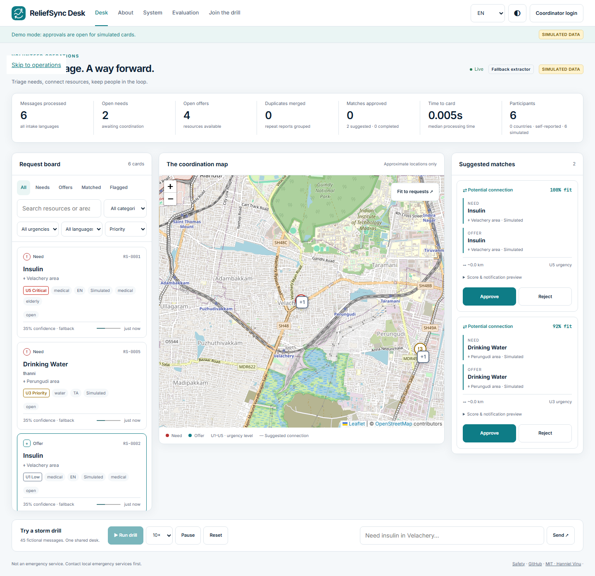
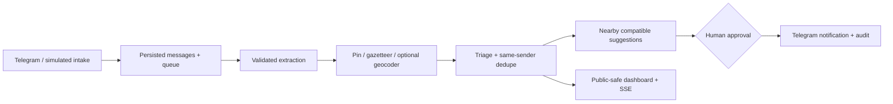

# ReliefSync Desk

**From chat chaos to coordinated rescue, with a human in the loop.**

ReliefSync Desk helps a volunteer dispatch coordinator turn multilingual Telegram messages into structured needs and offers, group repeat reports, prioritise urgent requests, and review nearby resource matches. A person approves every connection before a notification is posted. The dashboard includes a fully fictional storm drill that works without credentials. This is a hackathon prototype, not an emergency service.

**LIVE DEMO URL: (to be added after deployment).** Local preview: http://127.0.0.1:8000.

Repository: [hannielvinu/ReliefSync-Desk](https://github.com/hannielvinu/ReliefSync-Desk). Track: **Civic and Real-World Impact**.



## Why this exists

Residents reported busy and unanswered civic helplines during Chennai’s December 2023 floods: [The News Minute](https://www.thenewsminute.com/amp/story/tamil-nadu/chennai-floods-helplines-inundated-people-struggle-to-contact-authorities), [DT Next](https://www.dtnext.in/news/city/calls-to-govt-helplines-go-unanswered-754073). A volunteer account describes at least a thousand daily requests and reviewing more than 50,000 requests, including repeats: [volunteer diary](https://www.dtnext.in/volunteer-diaries-we-had-calls-regarding-pregnant-women-being-stranded). [Another report](https://www.dtnext.in/news/city/volunteers-the-undying-spirit-of-chennai-soars-on-social-media-753635) describes miscommunication and resources redirected despite coordination groups.

During the October–November 2024 Valencia floods, volunteers organised on Telegram, WhatsApp and Facebook, including a Telegram channel above 14,000 members: [volunteer organising](https://www.izquierdadiario.es/Desborde-de-solidaridad-ante-la-inaccion-del-Gobierno-miles-de-voluntarios-autoorganizados-se). Reports also describe [disorganised coordination](https://inspain.news/?p=40691) and [a fake emergency number](https://thestar.com.my/tech/tech-news/2024/11/08/online-disinformation-exacerbates-spain-flood-disaster). [Tambaram’s community helpline](https://citizenmatters.in/citizen-monsoon-helpline-in-tambaram/) offers a practical volunteer model, with about 70 volunteers across five zones. These reports motivate the problem; none is a partnership or product endorsement.

## Run locally in three commands

Clone or download this repository first. In its root, with Python 3.11+ on Windows:

```powershell
py -3.11 -m venv .venv
.\.venv\Scripts\python.exe -m pip install -r requirements.txt
.\.venv\Scripts\python.exe -m uvicorn app.main:app --host 127.0.0.1 --port 8000 --no-access-log
```

On Linux/macOS, use `python3 -m venv .venv`, `.venv/bin/python -m pip install -r requirements.txt`, then `.venv/bin/python -m uvicorn app.main:app --host 127.0.0.1 --port 8000 --no-access-log`.

Open **http://127.0.0.1:8000**, select **10×**, then **Run drill**. An insulin need and offer appear first, followed by a suggested match. Expand its notification preview, approve, then complete it. Without a configured bot, notification status is `would_send`; simulated cards never send to Telegram. `/health` reports actual service status. `/api/docs` documents endpoints.

## How it works



- Tamil, Tanglish, English, Spanish and German examples; configurable multilingual extraction provider.
- Offline rules with visible confidence and fallback labels; provider retry and circuit breaker.
- Needs, offers, urgency, repeat counts, possible-incident clusters and flagged misinformation.
- Leaflet map with approximate public positions, keyboard-accessible request list, details drawer.
- Score and notification preview, approval conflicts handled transactionally, completion and coordinator edits.
- Telegram polling or authenticated webhooks; edits, location pins, `/forget`, `/iam`, `/status`.
- English/Tamil/Spanish/German shared UI, light/dark themes, mobile tabs and reduced-motion support.
- 45-message synthetic drill, 65-message synthetic evaluation, screenshots and silent demo recording script.

## Real vs simulated

| Component | Status |
| --- | --- |
| Intake → extraction → cards → suggestions → approval → completion | Executed locally against the real application |
| Telegram transport and provider API | Implemented and tested with HTTP mocks; credentials required for live verification |
| Demo scenario, participants and requests | Fictional, labelled Simulated; never posted to real Telegram chats |
| LLM extraction | Provider configurable; current checked-in evaluation uses offline fallback only |
| Geocoding | Local gazetteer works offline; optional external lookup is cached and rate limited |
| Vultr hosting / public URL | Deployment assets supplied; no server provisioned or live URL claimed |
| Reach counts | Records, including simulations; countries are self-reported and unverified |
| Native Tamil review | Review worksheet supplied; independent native-speaker sign-off pending |

## Configuration

Copy `.env.example` to `.env` when connecting services. Keep it outside Git. Development demo defaults need no file. Generate independent random `SALT` and `COORDINATOR_TOKEN` before production. Development without a persistent SALT uses an ephemeral salt and sessions; for repeat Telegram tests always set SALT.

| Variable | Purpose |
| --- | --- |
| APP_ENV | `development` or `production`; production enforces strong secrets |
| PUBLIC_BASE_URL | External URL; HTTPS enables Secure cookies |
| DB_PATH | SQLite path; Compose overrides this to the persistent runtime volume |
| SALT | Stable secret for sender hashes and signed sessions; ≥32 characters in production |
| COORDINATOR_TOKEN | Login credential; ≥24 characters in production |
| DEMO_MODE | Open simulated approvals; real cards always require authentication |
| TELEGRAM_BOT_TOKEN / TELEGRAM_BOT_USERNAME | BotFather token and bot username |
| TELEGRAM_MODE / TELEGRAM_WEBHOOK_SECRET | Polling default; webhook requires HTTPS and a strong secret |
| TELEGRAM_ACK_MODE | `short` or `off` |
| TEST_GROUP_URL / FEEDBACK_URL | Optional tester links on `/join` |
| LLM_BASE_URL / LLM_API_KEY / LLM_MODEL | Provider Chat Completions URL, secret and model identifier |
| LLM_JSON_MODE / LLM_TIMEOUT_S / LLM_CONCURRENCY | JSON object mode, timeout and worker count |
| ALLOW_FALLBACK_EXTRACTOR | Use visibly labelled rules on unavailable extraction |
| GEOCODER_URL / GEOCODER_USER_AGENT | Opt-in lookup endpoint and identifying contact; empty by default |
| MATCH_RADIUS_KM / MATCH_MIN_SCORE | Match distance cap and weighted threshold |
| DEDUPE_WINDOW_MIN | Same-sender repeat window |
| LOG_LEVEL | Application logging severity; message text and tokens excluded |
| SITE_ADDRESS | Caddy domain, or `:80` for HTTP by IP |

Telegram setup: create `/newbot` through BotFather, disable privacy using `/setprivacy`, add the bot to your group, configure `.env`, restart, then post a text need and offer. See [full Telegram guide](docs/TELEGRAM_SETUP.md). Do not run two polling instances for one token.

## Validate

```powershell
.\.venv\Scripts\python.exe -m pip install -r requirements-dev.txt
.\.venv\Scripts\ruff.exe check app scripts tests
.\.venv\Scripts\ruff.exe format --check app scripts tests
.\.venv\Scripts\pytest.exe --cov=app --cov-fail-under=80
.\.venv\Scripts\python.exe scripts/eval.py
.\.venv\Scripts\python.exe -m playwright install chromium
.\.venv\Scripts\python.exe scripts/screenshots.py
```

Use the corresponding `.venv/bin/` commands on Linux. Screenshot checks need the running local server in demo mode. They reset simulated records. Record a silent walkthrough with `python scripts/screenshots.py --record`; output: `reports/demo-walkthrough.webm` (ignored by Git).

Latest checked-in [evaluation report](reports/eval_report.md): **65 synthetic samples, fallback extractor**; intent/category/resource/location **98.5%**, urgency within one level and misinformation **100%**. These are template smoke checks, not real-world accuracy claims. Full expected/actual data and per-language results are on `/eval`. Rerun the command after changing the extractor; source of truth is `reports/eval_report.json`.

## Deployment

The [Vultr guide](deploy/DEPLOY.md) covers Ubuntu, Docker Compose + Caddy, HTTPS, Telegram, verification, updates and SQLite backups. One application process serves API and assets. Do not increase Uvicorn workers: queue ownership, polling and limits are process-local.

```bash
sudo env PUBLIC_BASE_URL=https://desk.example.org SITE_ADDRESS=desk.example.org bash deploy/setup_vultr.sh
```

This command runs **on your Vultr instance**, after cloning the repo and configuring DNS. Docker/Ubuntu execution was not available in the Windows development environment; deployment must be smoke-tested on the server.

## Project map

`app/`: typed backend, extraction, geo, triage, Telegram and API. `static/`: buildless UI, self-hosted fonts and Leaflet. `data/`: fictional drill, labelled evaluation and locality gazetteer. `tests/`: unit and integration tests. `scripts/`: evaluation, seeding/purge, screenshots and data/page rebuild tools. `deploy/`: Docker, systemd and Caddy guidance. `docs/`: system design, safety, review, demo and submission material. `reports/`: reproducible evaluation and verification output.

## Safety and operating limits

Not an emergency service. Human approval does not verify identity or availability. Public endpoints hide routing identifiers, redact basic contacts/addresses and show fuzzed positions. Only authenticated coordinator detail exposes raw text and exact positions. `/forget` deletes sender records and rejects related matches; backups and Telegram copies need separate retention handling. See [threat model](docs/SAFETY.md).

This is Telegram only, without voice/call handling or WhatsApp group access. Rules cover a limited resource vocabulary and known localities; an unknown location stays unresolved. Rule-based English summaries retain source text. Language dictionaries cover shared navigation and operations labels; long informational pages remain in English. Tamil wording has not received independent native review. Tablet layout places the map above two panels. We have not claimed a WCAG certification, field trial, live provider test or live Telegram test.

OSM maps are for this low-volume demo: attribution remains visible, browsers cache tiles normally, and no bulk/offline tile downloads are supported. Remote geocoding is explicitly disabled until an operator opts in with a contact User-Agent. Respect the [tile policy](https://operations.osmfoundation.org/policies/tiles/) and [Nominatim policy](https://operations.osmfoundation.org/policies/nominatim/): at most one lookup per second, cached results, no autocomplete, no personal/confidential data, one application instance. Use another provider or self-host for sustained/bulk workloads.

## Roadmap

Voice notes; WhatsApp via an official business route; trust signals; individual coordinator roles; offline exports; independent accessibility and language review; field evaluation with consent.

MIT license. Author: **Hanniel Vinu**.
