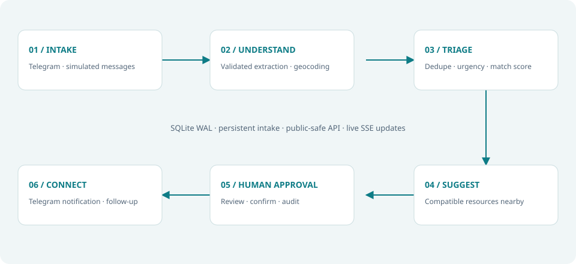
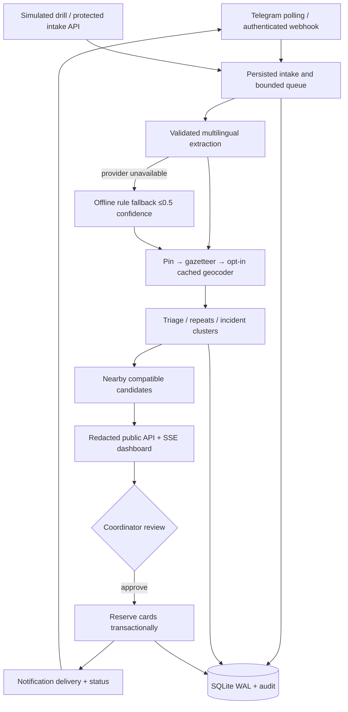

# System design





```mermaid
sequenceDiagram
  participant S as Sender
  participant T as Telegram
  participant P as Pipeline
  participant D as SQLite
  participant C as Coordinator
  S->>T: Text need / offer
  T->>P: Update (idempotent intake)
  P->>D: Persist queued message
  P->>P: Extract, locate, triage, score
  P->>D: Save card and suggested match
  P-->>C: SSE refresh + public-safe preview
  C->>P: Confirm approval
  P->>D: Reserve pair; reject conflicting suggestions
  P->>T: Approximate resource notification + mentions
  P->>D: Delivery status and audit
  C->>P: Mark complete
  P->>D: Fulfil both cards
```

## Components and choices

| Component | Responsibility / rationale |
| --- | --- |
| FastAPI + Pydantic v2 | Typed input validation, documented API and asynchronous service lifecycle |
| Uvicorn, one worker | One ownership point for polling, in-memory queue, rate limits and event broker |
| httpx | Async raw Telegram Bot API and configurable Chat Completions requests |
| aiosqlite / WAL | Low-operations durable storage for a small single-host demo; serial write transactions |
| RapidFuzz | Locality aliases, canonical resource similarity and repeat detection |
| Vanilla ES modules | No frontend build chain; direct same-origin API and event stream |
| Leaflet / OSM | Lightweight attributed map with a list alternative |
| Caddy / Docker / Vultr Compute | One-host deployment, automatic domain HTTPS, persistent data volume |
| pytest / respx / Playwright | Domain math, mocked transport, real local API workflow and browser checks |

## Data model

- `messages`: private routing IDs, hashed sender, raw/redacted text, simulation flag, timestamps, processing state, pin coordinates. `(chat_id, tg_message_id)` is unique.
- `cards`: one current card per message, resource fields, intent/category, location source/confidence, exact internal coordinates, urgency, language, extraction mode, duplicate parent/repeat count, possible incident cluster, state and timestamps.
- `matches`: need/offer references, distance, weighted score breakdown, state, coordinator decision, note and notification delivery state. Pair is unique.
- `participants`: hashed sender, first seen, optional self-reported country, simulation status.
- `audit_log`: state changes with actor, entity, ID, timestamp and non-text details.
- `geocache`: normalized query and cached geocoder result. `runtime`: durable polling offset.

Database schema is bootstrapped idempotently; no historical schema upgrades are needed yet. Future schema changes require explicit migrations before deploying onto old volumes. Exact positions remain internal except authenticated card detail. Public lists stay fuzzed even for a logged-in coordinator.

## Scoring and pagination

Priority = urgency×20 + min(repeats−1,5)×3 + min(waiting_minutes/10,10) + 5 for vulnerable flags. Priority sorting happens in SQL before pagination. Card cursors are offsets into the filtered sort; live changes can move records between pages, and the UI refreshes the first page after changes. Match cursors are ascending IDs. Limit is capped at 200. The map reflects loaded board cards; it is not a separate unbounded private-data feed.

Matching uses exact internal haversine distance, a compatible item similarity of at least 0.8, category, distinct senders, same simulation status, open cards and a 12-hour window. Weighted score: item .45, distance .25, need urgency .20, recency .10. Suggestions are limited to the top three per incoming card. Misinformation is excluded. Approval reserves a whole offer/card; partial quantities and split allocation are not modelled.

## Failures and recovery

| Failure | Behaviour |
| --- | --- |
| Provider timeout / invalid JSON | Retry once; rules fallback when enabled; five consecutive failed messages open a 60-second circuit |
| Missing / ambiguous location | Keep `needs_location`; trusted acknowledgement asks for pin; no match until resolved |
| Unknown provider or disabled fallback | Message marked failed; worker keeps running; health reports failed-message count |
| Process restart | Persisted queued messages are re-enqueued; polling offset resumes; in-progress uncommitted work rolls back |
| Full queue / sender flood | Reject intake with a consistent error; bounded queue and sender/IP limits |
| Edited source | Rerun extraction on the existing card; invalidate prior suggestions and approvals |
| Concurrent approvals | Serial transaction permits only the first valid resource allocation |
| Notification error | Approval stays recorded; delivery is visibly failed; explicit coordinator retry |
| Crash during notification | Delivery may be uncertain; inspect group history before retry; exactly-once delivery is not guaranteed by Telegram |
| Tile failure / SSE disconnect | Keep list usable; show map notice; event client reconnects and polls while disconnected |
| Sender deletion | Delete records, reject linked matches, reopen a surviving matched partner |

## Scaling limits

The first pressure points are extraction latency, SQLite’s serial writes, and in-memory queue/event fan-out. Add PostgreSQL with transactional job/outbox tables, a shared queue, distributed rate limits and individual coordinator identities before introducing multiple application instances. Move polling into one dedicated consumer or use authenticated webhooks; do not duplicate polling ownership. Replace public OSM services for sustained load. No high-availability or field-readiness claim is made.
